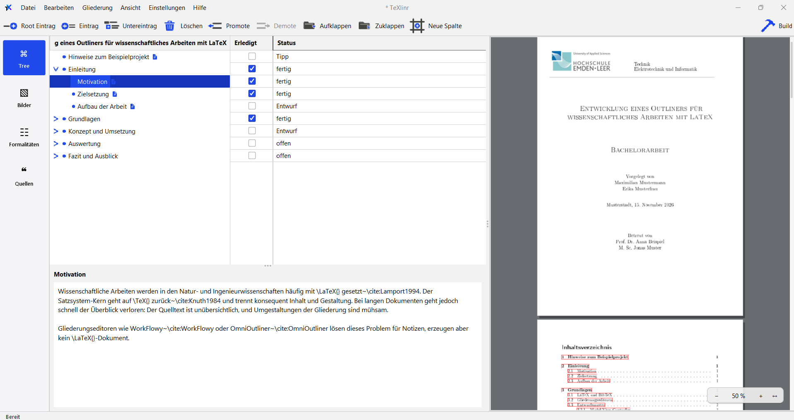

# TeXlinr


**TeXlinr** ist ein Outliner für wissenschaftliche Arbeiten. Du gliederst deinen Text als Baum, schreibst die Inhalte als LaTeX, verwaltest Abbildungen und Quellen in eigenen Bereichen und siehst das fertige PDF mit einem Klick direkt neben der Gliederung.

TeXlinr ist eine Weiterentwicklung von [JOutlinr](https://github.com/nille10/JOutlinr) (siehe [Herkunft und Lizenz](#herkunft-und-lizenz)) und befindet sich in der **Beta-Phase**.



## Funktionen

### Gliederung
- **Hierarchische Gliederung** mit bis zu drei Ebenen, die beim Export zu `\section`, `\subsection` und `\subsubsection` werden.
- **Bearbeiten per Maus und Tastatur:** Einträge erstellen, umbenennen, löschen, ein- und ausrücken, per Drag-and-drop verschieben, mit Strg-Klick mehrere auswählen.
- **Eigene Spalten** mit Kontrollkästchen oder Textfeldern (z. B. „Erledigt", „Status").
- **Rückgängig/Wiederholen** für Änderungen an der Struktur.
- **Suche mit Shift+Shift:** durchsucht den Inhalt aller Notizen. Suche mit Enter starten, mit den Pfeilen durch die Treffer springen, mit Esc schließen.

### Text und LaTeX
- **Notizen sind LaTeX:** Der Inhalt eines Eintrags landet unverändert im Dokument.
- **Kürzel für Abbildungen und Quellen:** `\fig:label` fügt die fertige `figure`-Umgebung ein, `\cite:schluessel` (auch mit mehreren, durch Komma getrennten Schlüsseln) wird zum Literaturverweis. Eine Vervollständigung schlägt beim Tippen passende Labels und Schlüssel vor.
- **PDF-Vorschau:** Mit F5 (oder Strg+B) wird die Gliederung als LaTeX gebaut, mit der lokal installierten TeX-Distribution kompiliert und rechts angezeigt. Zoom per Strg+Mausrad, Verschieben per Ziehen. Die Breite der Vorschau lässt sich mit dem Trenner anpassen.
- **LaTeX-Export** als `.tex` mit Standardmodus für den schnellen Export und Expertenmodus (Titelseite, Metadaten, Seitenformat).

### Bereiche
- **Bilder:** Bilderordner `img/` mit Vorschau, Drag-and-drop, Platzierung, Breite, Beschriftung und Label pro Bild.
- **Formalitäten:** Vorlage, Titelseite, Fachbereich, Abteilung, Titel, Art der Arbeit, Ort, Autoren, Betreuer, Logo, Seitenbreite, Seitenumbrüche und Seitenzahlen. Die Angaben werden mit dem Projekt gespeichert.
- **Quellen:** Literaturverwaltung für Bücher, Buchkapitel, Zeitschriftenartikel, Konferenzbeiträge, Internetseiten, Software, Abschlussarbeiten, Berichte und Sonstiges. Daraus entsteht die `references.bib` für klassisches BibTeX, ohne zusätzliche Software.

### Allgemein
- **Speichern und Laden** im XML- und JSON-Format, inklusive Formalitäten und Quellen. Das zuletzt verwendete Dokument wird beim Start wiederhergestellt.
- **Helles oder dunkles Design** und verschiedene Akzentfarben.
- **Tastenkürzel** für die wichtigsten Aktionen.

## Voraussetzungen

- **Java 21** oder neuer zum Ausführen der JAR-Datei.
- Eine **TeX-Distribution** für die PDF-Vorschau, z. B. [MiKTeX](https://miktex.org/) (Windows), [TeX Live](https://tug.org/texlive/) (Linux) oder [MacTeX](https://tug.org/mactex/) (macOS). TeXlinr nutzt `latexmk`, falls vorhanden, sonst `pdflatex` und `bibtex`. Die Programme müssen im `PATH` liegen. TeX gehört nicht zum Lieferumfang von TeXlinr.
- Zum Selbstbauen zusätzlich **JDK 21 oder neuer** und **Apache Maven**.

## Starten

Mit installierter Java-Laufzeitumgebung lässt sich die JAR-Datei direkt starten:

```bash
java -jar TeXlinr-1.0.0.jar
```

Der genaue Dateiname hängt vom jeweiligen Build ab.

## Selbst bauen

Im Projektordner:

```bash
mvn clean package
java -jar target/TeXlinr-1.0.0.jar
```

Maven lädt die Abhängigkeiten herunter und erstellt ein gebündeltes Paket. Alternativ lässt sich das Projekt in Eclipse oder IntelliJ IDEA importieren und direkt starten.

## Schnellstart

1. Einträge in der Gliederung anlegen und Text als LaTeX in das Textfeld schreiben.
2. Unter **Formalitäten** Titel, Autoren und Betreuer ausfüllen.
3. Bilder im Bereich **Bilder** hinzufügen und im Text mit `\fig:label` einfügen.
4. Quellen im Bereich **Quellen** erfassen und mit `\cite:schluessel` zitieren.
5. Mit **F5** das PDF bauen.

Zum Ausprobieren gibt es ein Beispielprojekt, in dem alle Funktionen verwendet werden.

## Herkunft und Lizenz

TeXlinr ist von **JOutlinr** abgeleitet, einem Outliner von nille10 und 1ngbert ([github.com/nille10/JOutlinr](https://github.com/nille10/JOutlinr)). Das Grundgerüst aus Baumansicht, Spalten, Speichern und Rückgängig stammt daraus.

Beide Projekte stehen unter der **MIT-Lizenz**, siehe [`LICENSE`](LICENSE). Die Lizenzen der verwendeten Fremdsoftware stehen in [`THIRD_PARTY_NOTICES.txt`](THIRD_PARTY_NOTICES.txt).

Teile des Quellcodes wurden mit Hilfe von KI erzeugt und sind im jeweiligen Dateikopf als „KI generiert" gekennzeichnet.

## Verwendete Technologien

- **Java / Java Swing**, plattformübergreifende Desktop-Anwendung
- **FlatLaf**, modernes Erscheinungsbild für Swing
- **Apache PDFBox**, Darstellung der PDF-Vorschau
- **Apache Maven** mit dem Shade Plugin, Build und gebündeltes Paket
- **LaTeX / BibTeX** der lokalen TeX-Distribution, Satz und Literaturverzeichnis
- **MVC-Architektur**, Trennung von Modell, Oberfläche und Steuerungslogik
- **XML und JSON** als Dateiformate

## Mitwirkung

TeXlinr befindet sich in der **Beta-Phase**. Fehlerberichte und Verbesserungsvorschläge sind willkommen.